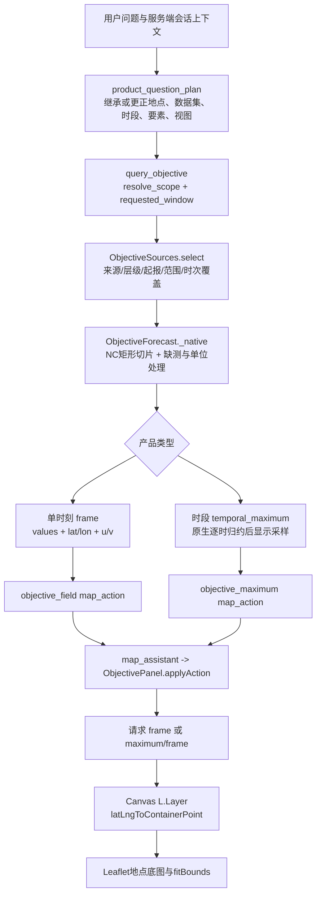

# NC 海浪、海面风二维地图绘制与 Claude 复审指南

本指南面向接手代码的 Claude 和开发者，说明现有绘图链路、可执行接口用法及仍需复核的边界。审查基于 2026-10-21 的代码与已有测试记录；本次文档工作没有重新调用问答模型、数据获取服务或业务接口。

**当前已经实现：** 从已登记 NC 读取海浪和海面风，在问题所指地点的 Leaflet 底图上绘制二维栅格；单时刻风场显示 u/v 箭头；另有时段逐格最大值、报告、下载和追问继承。接手时应保留和复核这些实现，不能把它们重新列为尚未开发的功能。

公开仓库不附带私有 NC、私有资料正文、原始问答 trace、运行索引或凭据。下面的示例从部署者自己的 catalog 取数据集与时次，不依赖某台电脑的文件路径，也不写死真实数据集 ID 或实际预报结果。

## 1. 先读这些代码

下列链接均相对于本仓库；行号对应本次交接快照，后续修改后应以函数名再次定位。

| 环节 | 入口与职责 |
|---|---|
| 注册运行时 | [`forecast_runtime/api.py`](../forecast_runtime/api.py#L101-L121)：初始化 `ObjectiveForecast`、`ObjectiveReport`、`ObjectiveSources`，登记本地资料并注册蓝图 |
| 本地 NC 导入 | [`tools/import_objective_nc.py`](../tools/import_objective_nc.py#L11-L17)：将本机已获授权的 NC 登记到运行索引，不复制原始大文件 |
| 地点范围 | [`objective_scope.py`](../forecast_runtime/objective_scope.py#L42-L82)：`resolve_scope(question, bounds=None)` 返回同一份范围对象 |
| 自然语言与地图动作 | [`objective_bridge.py`](../forecast_runtime/objective_bridge.py#L270-L324)：`query_objective`、`_field_product`、`_map_action`、`_maximum_action` |
| 连续追问 | [`objective_context.py`](../marine_kb/objective_context.py#L115-L212)：`product_question_plan`、`product_context` |
| NC 与原生网格 | [`objective.py`](../forecast_runtime/objective.py#L113-L180)：`_source_meta`；同文件的 `_native`、`_mask`、`frame`、`stats72`、`temporal_maximum` |
| 数据选取 | [`objective_sources.py`](../forecast_runtime/objective_sources.py#L62-L88)：`select` 检查来源、层级、空间范围、时间覆盖和起报时刻 |
| 时间覆盖 | [`objective_time.py`](../forecast_runtime/objective_time.py)：依据完整源时间轴推断采样间隔、预期时次与缺口 |
| 报告 | [`objective_report.py`](../forecast_runtime/objective_report.py#L444-L559)：全范围和各分区统计、快照、逐格最大值图与产品状态 |
| 读数与图片 API | [`objective_api.py`](../forecast_runtime/objective_api.py#L18-L101)：catalog、frame、maximum、point、availability |
| 报告与下载 API | [`objective_report_api.py`](../forecast_runtime/objective_report_api.py#L7-L54)：范围参数校验、report、报告附件 |
| 问答页面交付 | [`map_assistant.js`](../frontend/map_assistant.js#L139-L148)：消费回答中的 `map_action` |
| Leaflet 图层 | [`objective_panel.js`](../frontend/objective_panel.js#L103-L143)：`draw`、`renderLayer`、`load` |
| 动作执行 | [`objective_panel.js`](../frontend/objective_panel.js#L161-L200)：`validAction`、`applyAction` |
| 地图与底图 | [`index.html`](../frontend/index.html#L434-L475)：Leaflet 地图与天地图配置；同文件 `setMode` 切换客观预报面板 |

## 2. 完整链路：问题到提问地点的地图



具体顺序如下：

1. 问答规划器先处理追问。`query_objective` 再解析时段及 `scope`，其 `bounds` 同时传给选数、统计、报告和地图动作。
2. `ObjectiveSources.select` 默认在 L2/L5 内选择资料，检查所需要素及范围，并以 `min(查询参考时刻, 目标开始)` 限制起报批次。历史问题不能借用后来的起报资料。
3. `_native` 从 NC 按指定原生时次、指定矩形读取；程序负责数值计算，语言模型不生成二维数组或预报数值。
4. 单时刻问题走 `_field_product`；报告与过程问题走 `ObjectiveReport.report`。明确要求逐格最大值时返回最大值地图动作。
5. 回答元数据中的 `map_action` 由问答 API 传给页面；`map_assistant.js` 调用 `ObjectivePanel.applyAction`。
6. `applyAction` 验证字段、数据集 ID 格式、要素、带时区时间和范围，切换面板选择，再经 HTTP 获取数组。
7. `renderLayer` 创建 `L.Layer` 管理 Canvas；`draw` 把每个 `[lat, lon]` 投影为地图屏幕坐标，绘制有值的格子。平移、缩放和 resize 后重画。
8. `fitBounds([[south,west],[north,east]])` 定位到实际返回格点范围。旧图和旧弹窗在新请求开始时清除，迟到请求受序号与 epoch 保护。

**地图不是把下载 PNG 当成经纬度贴图。** 在线地图使用 `lat/lon/values` 绘制 Canvas；PNG 是独立下载产品。现有 PNG 带经纬度坐标轴、色标和批次/时刻说明，没有地图底图。若要新增带底图的分享图片导出，应作为扩展需求处理，并保留现有地图链路。

## 3. NC 变量、坐标、缺测与海陆掩膜

### 3.1 变量契约

| 数据家族 | 海浪 | 海面风 | 气压 |
|---|---|---|---|
| L2/L5 | `WAV`，暂按有效波高，单位 m | `u10/v10`，`speed = hypot(u10,v10)`，单位 m/s；暂按 10 米阵风产品解释 | 未提供 |
| ECMWF | `swh`，单位 m | `10u/10v`，合成 10 米风速，单位 m/s；与 L2/L5 的临时阵风解释区分 | `msl`；Pa 时除以 100 转为 hPa |

变量与解释版本见 [`objective.py:21-37`](../forecast_runtime/objective.py#L21-L37)、[`objective.py:154-170`](../forecast_runtime/objective.py#L154-L170)。L2/L5 的 WAV 统计间隔、阵风口径、无时区时间解释仍待业务确认。更改解释时须更新版本，防止复用旧解释的缓存。

L2/L5 的 MWD 元数据存在产品含义和单位疑点，当前不绘制浪向。不得自行把波高变量解释成浪向，也不得从 L2/L5 风速推导气压或混入其他来源的气压。

### 3.2 读取与排序

`_source_meta` 当前支持有限、严格单调的一维经纬度轴；变量维度为 `time,lat,lon` 或 `time,1,lat,lon`。它不是任意曲线网格的通用读取器。

[`_native`](../forecast_runtime/objective.py#L274-L313) 的关键约束：

- `valid_time` 必须匹配源原生时次；明确指定但没有的时次不插值、不替换。
- `bounds` 为 `[west,south,east,north]`，选取框内原生格点中心。
- 返回矩阵轴序为北到南、西到东，`axis_order = north_to_south_west_to_east`。
- 先按 `_FillValue`、`missing_value` 和相应产品哨兵识别缺测，再应用缩放和偏移；负波高设为缺测。
- 风速逐格合成，保留同一时刻的 u/v；不能先取 u、v 各自的时段最大值再合成。
- [`frame`](../forecast_runtime/objective.py#L346-L378) 先计算原生统计，再显示采样。改变 `maxsize` 不应改变原生最大值、位置及发生时刻。

### 3.3 掩膜的准确含义

[`_mask`](../forecast_runtime/objective.py#L315-L329) 支持 `none` 或 `wave_valid`。`wave_valid` 依据同数据集波浪源首帧的有限值构造模式海点掩膜，最近映射到待绘制要素原生网格，并限制在波浪源坐标覆盖内。

它是**模式有效海点掩膜**，不是精细岸线裁剪、行政海域多边形或淹没模型。一个海点对应的粗格仍可能覆盖部分岛陆；文档和界面不能承诺“已经精确裁到海岸线”。海点缺测也不能自动当作永久陆地，见第 8 节的待验证项。

## 4. 地点框与范围继承

范围配置版本为 `zhejiang_reference_boxes_v1`，见 [`objective_scope.py`](../forecast_runtime/objective_scope.py#L10-L27)。以下数字是配置中的参考范围，不是实际预报结果。

| 地点 | scope ID | W,S,E,N |
|---|---|---|
| 浙江近海 | `zhejiang` | `119.5,26.5,123.5,31.5` |
| 嘉兴近海 | `jiaxing` | `120.75,30.25,121.65,30.95` |
| 宁波近海 | `ningbo` | `121.30,28.85,122.60,30.40` |
| 舟山近海 | `zhoushan` | `121.75,29.45,123.15,31.10` |
| 台州近海 | `taizhou` | `121.10,28.05,122.55,29.25` |
| 温州近海 | `wenzhou` | `120.35,26.90,122.10,28.25` |
| 朱家尖近海 | `zhujiajian` | `122.33,29.82,122.53,30.02` |

浙江报告还包含北、中、南三个参考分区：

| 分区 | W,S,E,N |
|---|---|
| 北部 | `120.5,29.5,123.5,31.5` |
| 中部 | `120.0,28.0,123.5,29.5` |
| 南部 | `119.5,26.5,123.5,28.0` |

这些都是参考统计框，不能作为行政海域边界。各框可能重叠，分区格点数与统计结果不能相加冒充总面积。

`resolve_scope` 已有以下行为：显式 `bounds` 或“地图范围：W,S,E,N”优先；朱家尖比舟山更具体；同级多个地点保留各地统计，联合地图显示外接矩形；“改成/换成”优先使用更正目标。朱家尖有效原生海点不足时应明确覆盖不足，不得扩大到舟山或全省。

[`objective_context.py:161-196`](../marine_kb/objective_context.py#L161-L196) 已保留上一产品的数据集、范围、时段和视图；“最新批次”允许更换旧数据集锁定，“同一时段换成海面风”切换要素，明确指定单时刻可从最大值模式切回快照。由单时刻图转“报告”而未另写时长时，已有默认 72 小时的处理，不应误继承为一小时报告。

新业务、混合业务与范围外追问也有独立处理，见 [`objective_context.py:135-157`](../marine_kb/objective_context.py#L135-L157)。服务端保存的产品上下文应继续作为继承依据，不让客户端任意编造来源和统计范围。

## 5. 单时刻图、极值时刻快照与逐格最大值图

| 产品 | 计算 | 时间语义 | 风箭头 |
|---|---|---|---|
| 指定时刻分布图 | `frame` | 全部格点共享一个 `valid_time` | 用该时刻同一格点 u/v |
| 区域极值时刻快照 | `image_png`，有效时刻取区域峰值发生时刻 | 在一个共同峰值时刻观察全场；不是每格自己的最大值 | 同一快照时刻的 u/v |
| 时段逐格最大值图 | `temporal_maximum` | 每格分别对窗口原生时次取最大，各格峰值时刻可不同 | 明确省略，不能拼接不同时间的风向 |

[`temporal_maximum`](../forecast_runtime/objective.py#L473-L558) 逐次读取原生矩形并归约，之后才显示采样；返回 `valid_sample_counts`、`valid_sample_ratios` 和时间覆盖。不能用某一张区域峰值快照替代逐格时段最大值。

时段包含起止端点。对于起止都对齐原生逐小时时次的 72 小时窗口，通常有 73 个时次；非整点窗口、不同采样间隔或缺时次时，必须按源时间轴推断，不能一律硬编码 73。

前端单时刻风箭头见 [`objective_panel.js:116-122`](../frontend/objective_panel.js#L116-L122)：正 u 向东、正 v 向北，屏幕坐标用 `atan2(-v,u)`，箭头表示风吹向。不能把它直接写成气象学风来向。PNG 箭头由 [`image_png`](../forecast_runtime/objective.py#L605-L609) 的 `quiver` 绘制。

报告同时保留 `wave_peak.png`、`wind_peak.png` 和 `wave_maximum.png`、`wind_maximum.png`，见 [`objective_report.py:515-540`](../forecast_runtime/objective_report.py#L515-L540)。普通报告的地图动作默认采用首要素的极值时刻快照；明确要求“逐格最大值图”才返回 `objective_maximum`，见 [`objective_bridge.py:312-323`](../forecast_runtime/objective_bridge.py#L312-L323)。

## 6. API 契约、坐标顺序与时间编码

| GET 接口 | 主要参数 | 返回/行为 |
|---|---|---|
| `/api/objective/catalog` | 无 | `datasets`，每要素 `valid_times`、覆盖、单位与解释；`report_scopes` |
| `/api/objective/frame` | `dataset_id,field,valid_time,bounds,maxsize,sea_mask` | 单时刻二维数组；风含 u/v；原生统计与源标识 |
| `/api/objective/image.png` | 同单时刻参数 | 经坐标轴绘制的 PNG，不是带底图地图截图 |
| `/api/objective/maximum/frame` | `dataset_id,field,start,hours,bounds,maxsize,sea_mask` | 逐格时段最大值与有效样本数/比例 |
| `/api/objective/maximum/image.png` | 同时段参数 | 时段最大值 PNG |
| `/api/objective/point` | `dataset_id,field,valid_time,lon,lat` | 最近原生格点值和格点中心；缺测不补值 |
| `/api/objective/availability` | `dataset_id,start,hours,bounds,fields` | 时间轴、空间覆盖和批次资格检查；不代替数值缺测核对 |
| `/api/objective/report` | `dataset_id,start,hours,scope` 或 `bounds`；可选 `fields,question,wave_threshold,wind_threshold` | 报告结果、状态、附件与缓存信息 |
| `/api/objective/reports/{report_id}/{filename}` | 由实际响应取得路径；可选 `download=1` | 已生成报告附件；不能传源 NC 文件路径 |

参数与状态约束：

- `field` 为 `wave`、`wind` 或 `pressure`；无气压的 L2/L5 返回未提供，不拼接其他来源。
- `bounds` 始终为 `west,south,east,north`。只在调用 Leaflet 时转换为 `[[south,west],[north,east]]`。
- 时间建议使用带明确时区的 ISO 8601 字符串。URL 中 `+08:00` 的 `+` 必须编码；Python 用 `requests.get(..., params=...)`，浏览器用 `URLSearchParams`，不要手工拼接未经编码的参数。
- 公开报告/时段 API 的 `hours` 为 1–168；`maxsize` 为 2–1200 的整数。内部引擎允许的范围不能当作公开 API 的承诺。
- 同时提交 `scope` 与 `bounds` 时必须一致，否则拒绝；公开报告接口不接受调用方自写的完整 scope 对象。
- API 阈值输入是非负有限值，单位沿用要素单位；自然语言“超过”与“≥”的比较运算应分别保留。阈值是用户筛查条件，不是正式预警分级。
- 留意 `state`、`code`、`partial`、`spatial_partial`、`temporal_coverage` 和各要素状态，不能只用 HTTP 200 判断数据完整。
- `frame.bounds` 为实际格点中心的范围，`requested_bounds` 为请求范围，两者不保证相同。不得把实际交集当作所问全域覆盖。
- 最大值模式没有单一有效时刻，前端已禁用该模式的单时刻地图点查，见 [`objective_panel.js:209`](../frontend/objective_panel.js#L209)。

### 6.1 可执行 Python requests 示例

从仓库根目录运行本机应用后，可将下面代码保存为临时脚本并运行。它只请求客观产品 API，不调用问答模型；`--with-report` 才额外生成/复用报告。示例不下载新 NC，也不把业务响应写入仓库。

如果尚未登记资料，先通过应用已有获取流程准备数据，或运行 `python tools/import_objective_nc.py <自己的NC目录>`。不要把他人的运行索引或源路径复制为部署配置。

```python
import argparse
from datetime import datetime, timedelta, timezone
import json
import math
import os

import requests

parser = argparse.ArgumentParser()
parser.add_argument("--base", default=os.getenv("OCEAN_BASE_URL", "http://127.0.0.1:8767"))
parser.add_argument("--scope", default="zhujiajian")
parser.add_argument("--with-report", action="store_true")
args = parser.parse_args()
base = args.base.rstrip("/")
session = requests.Session()


def iso(value):
    result = datetime.fromisoformat(value.replace("Z", "+00:00"))
    if result.tzinfo is None:
        raise ValueError("catalog 时间必须带时区")
    return result


def get(path, params=None):
    response = session.get(base + path, params=params, timeout=120)
    response.raise_for_status()
    return response


def get_json(path, params=None):
    return get(path, params).json()


catalog = get_json("/api/objective/catalog")
scope = next((row for row in catalog.get("report_scopes", [])
              if row["id"] == args.scope), None)
if scope is None:
    raise SystemExit("所选 scope 不在部署实例的 catalog 中；请检查 report_scopes")
bounds = scope["bounds"]


def covers(source_bounds):
    w, s, e, n = source_bounds
    return w <= bounds[0] and s <= bounds[1] and e >= bounds[2] and n >= bounds[3]


# 仅选择本实例已登记、已经起报、具备双要素和所选范围的 L2/L5。
# 从该数据集的共同原生时次选取一个可跨 72 小时的窗口。
selected = None
now = datetime.now(timezone.utc)
rows = sorted(catalog.get("datasets", []), key=lambda row: iso(row["batch"]), reverse=True)
for dataset in rows:
    fields = dataset.get("fields", {})
    if dataset.get("source_family") != "zjocean_l2_l5":
        continue
    if iso(dataset["batch"]) > now or not all(name in fields for name in ("wave", "wind")):
        continue
    if not all(covers(fields[name]["coverage"]) for name in ("wave", "wind")):
        continue
    common = sorted(set(map(iso, fields["wave"]["valid_times"]))
                    & set(map(iso, fields["wind"]["valid_times"])))
    starts = [value for value in common
              if value >= iso(dataset["batch"]) and value + timedelta(hours=72) <= common[-1]]
    if starts:
        selected = dataset, starts[0]
        break
if selected is None:
    raise SystemExit("没有符合范围、起报和双要素要求的 72 小时资料；不得换地点或伪造值")
dataset, start = selected
identifier = dataset["dataset_id"]  # 运行时从 catalog 获取，不写死。
box = ",".join(str(value) for value in bounds)
period = dict(dataset_id=identifier, start=start.isoformat(), hours=72,
              bounds=box, maxsize=180, sea_mask="wave_valid")
availability = get_json("/api/objective/availability", {**period, "fields": "wave,wind"})
print("时间轴/空间/批次覆盖完整:", availability["complete"])

for field in ("wave", "wind"):
    instant = dict(dataset_id=identifier, field=field, valid_time=start.isoformat(),
                   bounds=box, maxsize=180, sea_mask="wave_valid")
    frame = get_json("/api/objective/frame", instant)
    if frame.get("state") != "ready":
        raise SystemExit(f"{field}: 单时刻无有效数据；不替换其他时刻或地点")
    assert frame["axis_order"] == "north_to_south_west_to_east"
    assert frame["requested_bounds"] == bounds
    if field == "wind":
        for speeds, us, vs in zip(frame["values"], frame["u"], frame["v"]):
            for speed, u, v in zip(speeds, us, vs):
                if speed is not None:
                    assert u is not None and v is not None
                    assert math.isclose(speed, math.hypot(u, v), rel_tol=0, abs_tol=2e-6)
    png = get("/api/objective/image.png", instant)
    assert png.content.startswith(b"\x89PNG\r\n\x1a\n")

    maximum = get_json("/api/objective/maximum/frame", {**period, "field": field})
    assert maximum["product_type"] == "temporal_maximum"
    assert maximum["valid_time"] is None
    if field == "wind":
        assert maximum["vectors_omitted"] and "u" not in maximum and "v" not in maximum
    print(field, "instant:", frame["state"], "maximum:", maximum["state"],
          "time partial:", maximum.get("partial"),
          "space partial:", maximum.get("spatial_partial"))

if args.with_report:
    report = get_json("/api/objective/report", {
        **period, "scope": scope["id"], "fields": "wave,wind",
    })
    print("report state:", report["state"], "cache hit:", report.get("cache_hit"))

# 这些动作是从本实例 catalog 构造的开发检查输入。
# 正常产品流程由服务端回答中的 map_action 自动交付，不让用户手工填写。
actions = {
    "snapshot": dict(type="objective_field", dataset_id=identifier, field="wind",
                     valid_time=start.isoformat(), bounds=bounds),
    "maximum": dict(type="objective_maximum", dataset_id=identifier, field="wave",
                    start=start.isoformat(), hours=72, bounds=bounds),
}
print(json.dumps(actions, ensure_ascii=False, indent=2))
```

脚本的 `complete` 为 false 时，继续查看具体覆盖字段，不能据此声称完整 72 小时覆盖。脚本检查风速合成和输出结构，不替代独立 NC 数值验算、方向测试或浏览器视觉验收。运行时输出属于部署者实例，不应提交为公开 trace。

### 6.2 在现有地图中检查 map_action

正常流程已经自动执行动作。开发检查时，在主页已加载后，可将上面输出的某个动作对象赋给浏览器控制台变量 `action`，再执行：

```javascript
await window.ObjectivePanel.applyAction(action);
```

`objective_field` 必须带 `valid_time`，不能带 `start/hours`；`objective_maximum` 必须带 `start/hours`，不能带 `valid_time`。动作仅允许白名单字段，不能加入任意 URL、HTML、源文件路径或可执行代码。

`applyAction` 会核对 catalog，拒绝未登记批次或缺少的原生时刻，而不是绘制另一个批次/时刻来凑图。实际应用还传入 `isCurrent`，以便重置对话或新请求取消旧地图交付。地图加载失败时保留回答，并显示地图说明。

## 7. 已有验证的证据边界

以下是交接前已有记录的摘要，不是本指南编写时的新运行结果，也不构成所有数据、地点与语义均正确的证明：

- Python 回归记录：**2289 tests passed，134 subtests passed**。
- Node 页面测试：两个测试文件通过，覆盖批次/时次选择、要素切换、安全动作和链接、失败清旧图层、请求竞争取消及回答保留。
- 真实自然语言事务：**8 次**，其中 7 个业务状态为 ready、1 个为 no_data；48 项响应结构检查通过。
- 其中 6 个报告事务观察到合计 **48 次模型调用**，实际展示模式为 `business_data`。不能将它宣传为已完成独立语言模型长篇总结，也不能将 48 项检查写成 48 次独立问答。
- 另有 8 组产品 API 场景及独立 h5py 读取 NC 的逐格最大值、样本数、轴、时次和阈值过程核对；这些属于不同验证层，不与问答事务数混算。
- 缓存、查询窗口元数据、历史起报资格、无覆盖处理和跨进程回放另有记录。它们不消除临时变量解释、未登记地点和精细岸线等边界。

公开交接只保留上述摘要和可复现代码；不为支撑摘要而附带私有预报数值、来源全文或原始 trace。接手者需要实数验算时，应在获授权的数据环境中执行，并单独保管证据。

## 8. 静态审查发现：需要验证后再决定修改

### 8.1 未登记地点可能退成全省或沿用旧范围

[`objective_scope.py:64-70`](../forecast_runtime/objective_scope.py#L64-L70) 未命中固定地名时默认返回浙江；[`objective_context.py:181-185`](../marine_kb/objective_context.py#L181-L185) 的显式地点检测也采用固定名单。因此“绘制嵊泗明天08时海浪二维图”或“同一时段换成普陀附近”需要特别检查。

这是代码路径上的疑点，**本次未运行上述问题，不宣称已复现失败**。Claude 应先证明实际路由和范围结果，再考虑可配置地点注册、明确范围输入或定位澄清。验收要求是未知地点不得静默套用全省或上一地点；不应只针对两个示例地名补分支。

### 8.2 源首帧掩膜与时段海浪有效性可能不一致

`_mask` 在 [`objective.py:322`](../forecast_runtime/objective.py#L322) 使用波浪源首帧；[`stats72:432-435`](../forecast_runtime/objective.py#L432-L435) 为整个时段复用这个 mask。另一方面，[`temporal_maximum:520-528`](../forecast_runtime/objective.py#L520-L528) 已为海浪允许“首帧缺测、后续恢复有效”的格点参与最大值。

请用合成 NC 验证：某个海点在源首帧缺测，后续恢复，且恢复时出现应计入的峰值或超阈值；报告峰值、分区过程、有效样本数、快照和最大值图能否保持一致。现有 [`test_objective_process_upgrade.py:100-117`](../tests/test_objective_process_upgrade.py#L100-L117) 已覆盖最大值图保留后续有效点，但不能据此推断 `stats72` 的相同语义也已经验证。

这是待复核的一致性边界，不是本次实测故障结论。若需要统一，应先区分永久陆地 mask 与时变缺测，防止修复时把真正陆地点纳入统计。

### 8.3 多要素请求目前只向地图交付首要素

[`_field_product:118-126`](../forecast_runtime/objective_bridge.py#L118-L126) 和 [`query_objective:313-323`](../forecast_runtime/objective_bridge.py#L313-L323) 使用首要素生成单个动作；[`map_assistant.js:139`](../frontend/map_assistant.js#L139) 即使遇到动作数组也只取首个。当前用户可以在面板切换海浪和海面风。

不能声称已同时叠加或并排比较风浪两图。请验证“同时显示海浪和海面风”实际交付是否符合界面说明；若要扩展，明确采用图层切换、分屏或多图比较，不能把两个色标不明的标量场直接混成一层。

### 8.4 精细地理与业务定义仍有边界

当前是矩形框和模式海点，尚无精细行政海域或海岸线多边形裁剪。若新增精细边界，应有来源和版本，保留原生数值及缺测，不能靠平滑或插值宣称提升岸边精度。

变量定义核定后，应同步 `profile`、解释版本、图例、风箭头说明、报告文字及缓存身份。图表不能被解释为实况、正式预警、灾损或活动许可。

## 9. Claude 的复审顺序与验收

先读取第 1 节入口，建立已有功能清单，再检查第 8 节疑点。优先补能揭示真实差异的合成 NC 和交互验证，避免围绕实现细节堆重复测试或只按示例问句做特判。

### 9.1 自然语言与地图场景

时刻应从部署实例 catalog 选择已有原生时次；“明天”类输入若源不覆盖，正确结果是明确无覆盖。

1. “给我朱家尖未来72小时风浪简报，并显示海浪逐格最大值图。”
2. 追问：“同一时段换成海面风逐格最大值图。”
3. 追问：“改成所选日期08时的海浪单时刻图。”测试时把所选日期替换为 catalog 中确有该时次的日期。
4. 追问：“同一时刻换成海面风。”
5. 追问：“换成宁波，其他条件不变。”
6. 追问：“换成嵊泗附近，其他条件不变。”核对未知地点边界，不允许静默退省或保留旧地点。
7. 请求没有的原生时刻、没有的气压、空间覆盖不完整的数据集及完全不覆盖的窗口。
8. 请求同级多地点，核对各地点独立统计与联合地图的说明；再检查“同时显示风浪”是否明确当前只显示一个要素。

### 9.2 通用通过标准

- **来源与范围一致：** 回答、地图、报告的 dataset、batch、field、请求范围和窗口一致；已知小地点不扩省，未知地点不静默代答；部分空间覆盖明确标记交集。
- **时间可追溯：** 单时刻匹配原生时次；历史起报资格正确；时段按源时间轴算预期样本，端点与内部缺时次均受检查。
- **统计独立于显示：** 原生统计先于下采样；变更 `maxsize` 不改变原生极值、位置、时刻；逐格最大值逐格与独立归约一致。
- **风的合成和方向正确：** 速度为同一时刻 `hypot(u,v)`；用可控的东、北、西、南四个向量检查前端及 PNG；最大值风图没有拼接风向。
- **缺测处理一致：** 缺测透明、不补零；无海点和全缺测不制造峰值；首帧缺测后恢复的场景在统计与图件间一致。
- **产品类型清楚：** 单时刻、区域峰值时刻快照、逐格最大值不混写；PNG 下载与在线地图底图叠加的用途明确。
- **交互稳定：** 失败、无数据和缺要素清理旧图；快速切换、重置与迟到请求不会恢复旧选择；地图错误保留完整文字回答。
- **报告可核查：** 源 SHA、范围、窗口、阈值、解释/算法版本可追踪；同条件改写问句可复用，条件改变不能误命中。
- **过程口径准确：** 有效海点比例不是地理面积比例；离散超阈时长按采样规则解释，缺时次断开，不能宣称同一格点持续超阈或连续观测。
- **地理与业务说明准确：** 参考框不冒充行政边界，粗模式格点不冒充浴场/钓点实况，用户阈值不冒充正式预警。

### 9.3 已有回归入口

从仓库根目录、在项目 Python/Node 环境中运行：

```text
python -m pytest -q tests
node --test tests/test_objective_panel.cjs tests/test_objective_map_actions.cjs
```

真实产品接口工具为 [`tools/test_objective_upgrade_products_20261021.py`](../tools/test_objective_upgrade_products_20261021.py)，需要相应本机应用与获授权 NC；该脚本不调用问答模型，但不能把它当作纯离线测试或默认假设公开仓库包含它所需的运行数据。真实问答工具另有模型调用和防重复执行逻辑，复审代码与离线测试不应顺手重跑收费问答。

底图由部署者自行设置 `TIANDITU_API_KEY`。密钥只进本机环境配置；公开文档仅保留变量名。数据导入、应用端口与模型配置以仓库部署说明及 `.env.example` 为准，不要求某台电脑已有目录、旧运行索引或特定私有数据集 ID。
